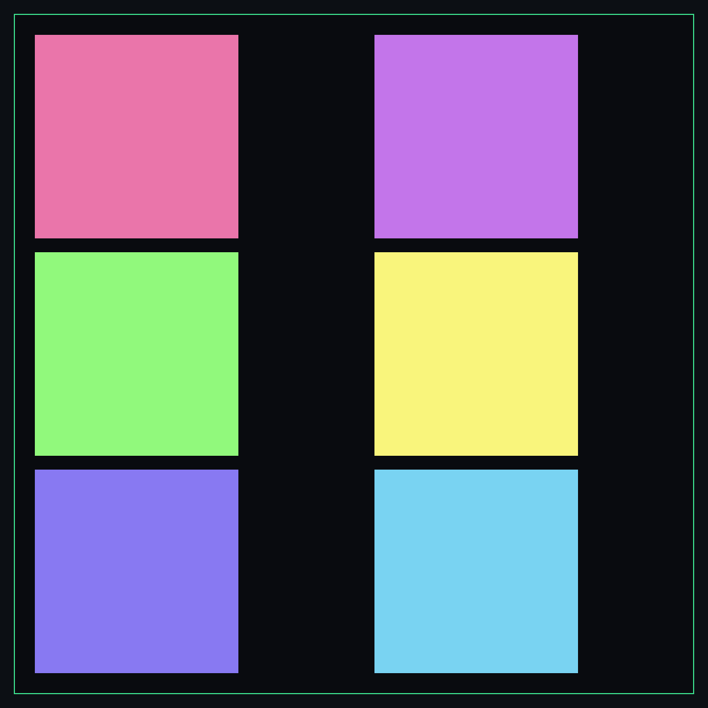
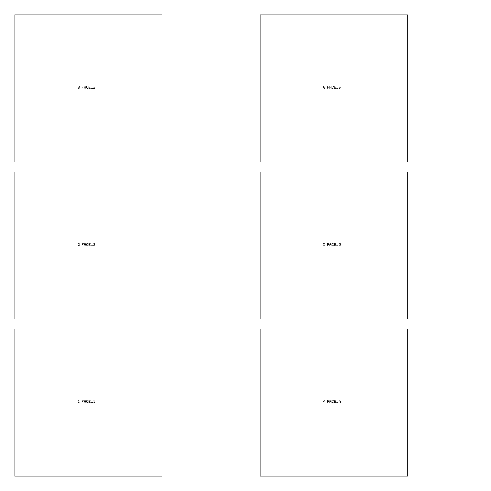

# uv-layout-extractor

Read-only UV layout sheets for Blender.

Two visual outputs from the same UV map:

1. **Line guide** — white background, black UV outlines, stable numeric IDs, optional
   names, numbered leader callouts and an island legend.
2. **Colored UV sheet** — dark full-bleed sheet, deterministic per-island colors and a
   green 0–1 frame. No title, labels or statistics.

It also includes a **layout gate** that reports geometric overlaps, actual raster pixel
collisions, out-of-bounds UVs and zero-area triangles, plus an optional per-chart repair
tool.




Tested with **Blender 5.2.2 LTS**. The scripts run inside Blender; there is no package
install and no bundler.

## Requirements

- Blender 5.2 (tested). Blender 4.2+ is likely to work but is not the supported version.
- NumPy, which ships with Blender.
- A mesh with one UV layer inside the single 0–1 tile.

Run everything in background mode so Blender cannot leave the file half-edited:

```bash
blender --background model.blend \
  --python-exit-code 1 \
  --python scripts/uv_color_layout.py -- \
  --object Body --uv UVMap --out out/color
```

## Quick start

### Colored sheet

```bash
blender --background model.blend \
  --python-exit-code 1 \
  --python scripts/uv_color_layout.py -- \
  --object Body --uv UVMap \
  --out out/color \
  --resolutions 1280 4096
```

Writes:

```text
out/color/1280/color_layout.png
out/color/4096/color_layout.png
out/color/color_manifest.json
```

The manifest records island count, UV bounds, per-island colors and UV space used.

### Line guide

```bash
blender --background model.blend \
  --python-exit-code 1 \
  --python scripts/uv_line_guide.py -- \
  --object Body --uv UVMap \
  --names examples/names.example.json \
  --out out/guide \
  --resolutions 1280 4096
```

Writes, per resolution:

```text
clean_guide.png
labelled_reference.png
island_legend.png
labels.json
```

plus `out/guide/guide_manifest.json`.

Names are optional. The JSON is either a simple map:

```json
{
  "1": "hood",
  "2": "cab_rear_panel",
  "31": "upper_body_shell"
}
```

or a list of objects with `id` and `name`. IDs not present are labelled with their
numeric ID only and marked `UNRESOLVED` in the legend.

### Layout gate

```bash
blender --background model.blend \
  --python-exit-code 1 \
  --python scripts/uv_layout_gate.py -- \
  --object Body --uv UVMap \
  --out out/gate \
  --resolution 4096
```

The gate reports:

- `geometric_overlaps` — exact triangle intersections
- `geometric_pairs` — face pairs, UV area, shared vertices and a sliver flag
- `non_sliver_geometric_pairs` — intersections not classified as adjacent-face slivers
- `pixel_conflicts` — actual UV texel collisions in the raster ID map
- `out_of_bounds`, `truncated`, `degenerate_triangles`
- `clean` — default pass/fail

By default the gate fails on pixel collisions, out-of-bounds UVs or truncation.
Adjacent-face geometric slivers are warnings. Use `--strict-geometric` to fail on any
triangle intersection as well.

## Optional repair tool

`extras/uv_chart_repair.py` rebuilds selected islands as isolated operands, unwraps each
one, fits it back into its original UV footprint and optionally repacks the sheet. It can
use Blender's unwrap or Mio3 UV if that add-on is installed.

**Run it on a copy, never the editable source.**

```bash
blender --background body_copy.blend \
  --python-exit-code 1 \
  --python extras/uv_chart_repair.py -- \
  --object Body --uv UVMap \
  --chart 6 --chart 7 --chart 31 \
  --engine blender \
  --method MINIMUM_STRETCH \
  --pack blender \
  --out out/repair
```

For Mio3:

```bash
--engine mio3 --relax 10
```

The repair report records the audit before and after and whether the island count
changed. It does not re-map names. If the layout changes, `extras/uv_rebind_names.py`
carries names onto the new IDs using the `faces` stored in the previous `labels.json`.

## Names and IDs

IDs are deterministic for a given UV layout:

```text
sort by (u_min, v_min, -face_count, uv_area)
```

That means IDs are stable across re-renders of the same layout, but **not** across a
different unwrap or repack. Treat names as a map from IDs to a specific layout, or rebind
them by face set after a repair.

## Adapting it into another project

The scripts are intentionally flat and have no project paths or hardcoded object names.
You can copy `scripts/` into another Blender toolchain and call the CLIs, or import the
core functions from your own Blender script:

```python
from uv_core import ordered_islands, mesh_islands, uv_triangles, rasterise

islands = ordered_islands(mesh, uv_layer)
```

`uv_core.ordered_islands()` gives the same deterministic ID order used by both renderers.
`uv_atlas_checks.validate()` is pure Python and can run outside Blender.

## Limitations

- Single 0–1 UV tile only; UDIM layouts are rejected.
- One object per run; run the tools once per mesh for multi-object assets.
- No bake, padding, texel-density certification or material transfer.
- The line guide and colored sheet render the layout they are given; they do not repair it.
- The gate does not check flipped-face orientation.
- Geometric slivers and raster collisions are different things; the gate reports both.
- Output directories are not overwritten unless `--force` is passed.

## Repository layout

```text
scripts/
  uv_core.py            shared island/raster/PNG helpers
  uv_atlas_checks.py    pure triangle intersection checks
  uv_line_guide.py      simple line guide
  uv_color_layout.py    colored sheet
  uv_layout_gate.py     overlap/bounds gate
extras/
  uv_chart_repair.py    optional per-chart repair (Blender or Mio3)
  uv_rebind_names.py    carry names across a layout change by face set
tests/
  test_atlas_checks.py  pure Python checks
  blender/              headless Blender fixture and smoke test
examples/
  names.example.json
  screenshots/
docs/
  inputs.md
  outputs.md
  limitations.md
```

## Development

Pure checks:

```bash
python3 -m unittest discover -s tests -p 'test_*.py'
```

Blender fixture:

```bash
BLENDER=/path/to/blender tests/blender/run.sh
```

The fixture creates a clean cube, runs both renderers and the gate, then creates a
deliberately overlapping layout and checks that the gate fails.

## License

MIT. See `LICENSE`.

The core tools have no third-party add-on dependency. Mio3 UV is an optional external
add-on used only by `extras/uv_chart_repair.py` when `--engine mio3` is selected.
